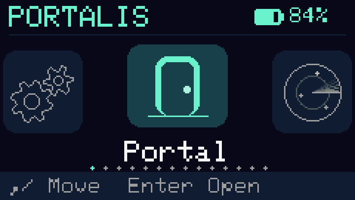
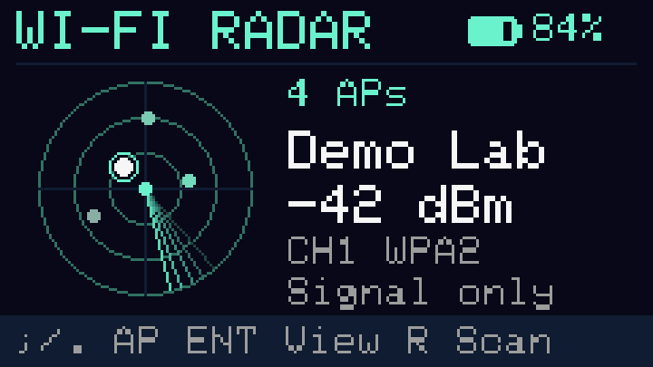
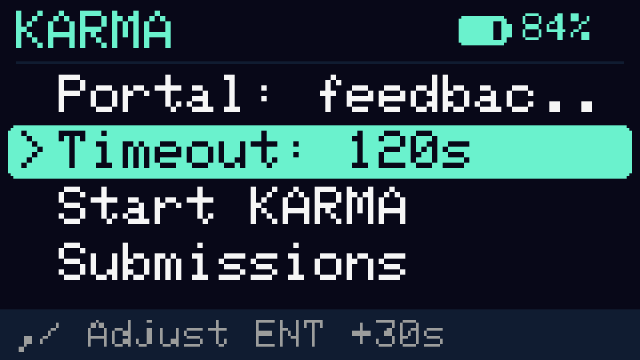
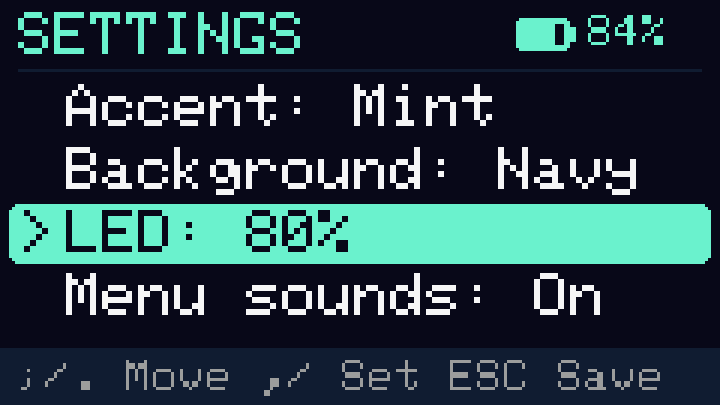
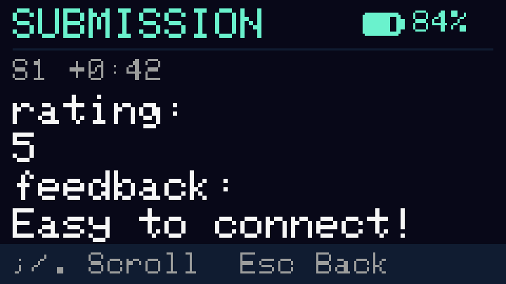

# Portalis

Wi-Fi captive portal firmware for **M5Stack Cardputer and Cardputer ADV**. Serve your own HTML pages, collect feedback on SD, browse submissions on the device, scan nearby Wi-Fi networks, and customize the display, RGB LED, and sounds.

## Screenshots

Rendered from the firmware UI using sample data at the display's 240×135 resolution, enlarged for readability. These are software previews, not photographs of a device.

<p align="center">
  
</p>

| Live portal dashboard | Wi-Fi radar |
| --- | --- |
|  |  |
| **KARMA setup** | **Device settings** |
|  |  |
| **Main menu** | **Saved feedback** |
|  |  |

## Install

Download **[portalis.bin from the latest release](https://github.com/ro8inmorgan/portalis/releases/latest)** and flash it at **`0x0`**. It is the complete image: bootloader, partition table, and application. Back up any existing firmware/settings first.

Releases contain only `portalis.bin` plus GitHub's automatic source-code ZIP and tar.gz downloads. You do not need a separate application binary.

1. Insert a FAT32 SD card for custom HTML pages and saved form submissions.
2. On a blank writable card, Portalis creates `/portalis.json` with the default settings.
3. Copy your HTML files to the card, or use the optional [example templates](sd-card). The normal Portal mode also has a built-in Aurora page.
4. Open **Portal**, choose an AP name and page, then select **Start portal**.
5. Join the network and open the captive-network notification, or visit **http://172.0.0.1**.

The AP is local and does not provide internet access. Broadcasting starts only when you choose Start.

## What you can do

### Portal

- Create an open 2.4 GHz access point with a typed name or a configured preset; supports up to four connected clients.
- Serve HTML/HTM pages from SD, including templates in subfolders, or use the built-in Aurora page.
- Browse templates alphabetically, with folders first, and reload the SD card from the picker.
- Collect feedback through ordinary HTML forms, with browser validation and a generic confirmation page after submission.
- Watch live client and confirmation counters, with animated pulses when their values change.
- View timestamp history and saved form submissions while the portal continues running.
- Remember the selected AP name and template across reboots.

### Wi-Fi radar

- Passively scan nearby 2.4 GHz access points and keep the strongest 32.
- Switch between an animated radar and a list showing SSID, signal strength, channel, and security.
- Refresh manually or let scanning refresh automatically.
- Stronger signals appear nearer the radar center. Position is illustrative, not a measured direction or distance.

The scanner lists access points, not connected client devices. Scanning and portal operation are mutually exclusive.

### KARMA / probe test

- Listen for named Wi-Fi probe requests and temporarily advertise the requested network name.
- Choose an SD HTML template before starting; there is no automatic built-in page for this mode.
- Capture feedback through the same form handler and SD submission viewer as Portal.
- Set the total AP lifetime before starting: **30–600 seconds**, in 30-second steps, default **120 seconds**. Joining does not restart the countdown.
- Apply a per-device cooldown between attempts; default **120 seconds**.
- View attempt and join counts, a remaining-time countdown, and the latest 32 test results.
- Remember the selected template and menu timeout across reboots.

The current implementation accepts any nonempty parsed SSID; it does not enforce an approved-name list. A recorded association does not prove that the device which sent the probe joined. MAC randomization also limits per-device cooldown accuracy. Stopping/restarting clears that session's cooldowns and counters.

### Templates and form inputs

Use a regular HTML form—no custom JavaScript or form action is required:

```html
<form>
  <label>
    Rating
    <select name="rating" required>
      <option value="">Choose a rating</option>
      <option value="great">Great</option>
      <option value="okay">Okay</option>
    </select>
  </label>
  <label>Feedback <textarea name="feedback"></textarea></label>
  <label><input type="checkbox" name="follow_up" value="yes"> Request follow-up</label>
  <button type="submit">Send feedback</button>
</form>
```

Portalis supplies a handler that posts the submitted form to `/confirm`. Supported data includes named inputs, textareas, selects, multiple selections, radio buttons, checkboxes, the clicked submit button, and small file uploads. Repeated names remain separate entries. Controls associated with a form using `form="id"` also work.

Normal browser rules apply: unchecked checkboxes/radios, disabled or unnamed controls, and unclicked buttons are omitted. Native `required`, `pattern`, and other validation rules still apply. Only the submitted form is recorded.

- Inline CSS and data-URL images are supported; external assets and template JavaScript are blocked.
- Templates: **32 KB** maximum.
- Submissions: **16 KB**, up to **64 entries**, with field names up to **256 bytes**.
- File uploads: **8 KB total**, stored with filename, MIME type, and base64 content.
- Each page ticket permits one accepted submission within five minutes. Reload for another submission.
- A writable SD card is required to accept submissions containing fields.

### Saved submissions and history

- Submissions are stored in `/portalis/submissions.jsonl`; timestamp events are stored separately in `/portalis/events.csv`.
- Browse submissions newest first and open them to read field names and values on the device.
- Scroll long values and see repeated fields separately. Uploaded files show metadata; retrieve their contents from the SD log.
- Saved records remain available after reboot. Original text and Unicode are preserved on SD; unsupported device-font characters display as `?`.
- Each log is capped at **256 KB**. Archive/remove it to resume logging when full. Failed submission saves show an error and allow retry.
- Portal confirmation history retains the newest 96 events in RAM. Times are elapsed session times, not calendar timestamps.

The Wi-Fi network is open and SD logs are unencrypted. Use feedback forms appropriate for that environment.

### Appearance, LED, and audio

- Six UI accent colors and three background palettes.
- Shimmering startup logo, animated carousel icons, pulsing counters, and an estimated battery percentage.
- LED brightness from 0–100%, plus independent idle, connection, confirmation, and disconnect colors.
- Five LED modes: **Breathing, Steady, Blink, Rainbow, Off**. Event flashes temporarily override idle animations.
- Live LED previews in Settings, including while the portal is stopped.
- Menu click sounds and separate connection, confirmation, and disconnect chimes.
- Independent menu/event sound toggles and volume from 0–100%.
- Device settings persist across reboots without needing an SD card.

On Cardputer ADV, LED power shares the display-backlight pin: active LED effects use full display brightness. Battery percentage is a voltage-based estimate, not a precise fuel gauge or charging indicator.

## Controls

| Screen | Keys |
| --- | --- |
| Main menu | `,` / `/` move between icons; Enter opens |
| Menus | `;` / `.` move; Enter selects; Esc/back returns |
| Template picker | Enter opens; Backspace goes up; `R` remounts SD |
| Portal dashboard | `S` submissions; `H` history; `C` settings; `X` stop confirmation |
| Radar | `;` / `.` select AP; Enter toggles radar/list; `R` refreshes; Esc stops |
| KARMA setup | Page selects HTML; Timeout adjusts with `,` / `/` or Enter (+30s); Start begins |
| KARMA shortcuts | `S` start/stop; `T` templates while stopped; `V` submissions; `H` log; `R` reload while stopped |
| Settings | `;` / `.` select; `,` / `/` adjust; Esc/Backspace saves |
| Submissions | `;` / `.` select or scroll; Enter opens; `R` refreshes the list |

Esc is the backtick-labelled key. The arrow-labelled keys are `;`, `.`, `,`, and `/`.

## SD configuration

Fresh installations create `/portalis.json` with:

```json
{
  "ap_names": ["Portalis Demo", "Portalis Guest", "Portalis Workshop"],
  "cooldown_seconds": 120,
  "timeout_seconds": 120,
  "notice_template": ""
}
```

- `ap_names`: up to 32 presets, each 1–32 printable ASCII characters, without leading/trailing spaces. Manual naming remains available.
- `cooldown_seconds`: 60–86400 seconds between attempts for a device.
- `timeout_seconds`: 30–600 seconds total lifetime for each temporary AP.
- `notice_template`: optional absolute path to a probe HTML file, such as `/feedback.html`. Empty means choose a file before starting.

The config is limited to 4 KB. Existing files are preserved. Saved KARMA menu selections override the config's template and timeout. Every start reloads the selected HTML file.

**Upgrading:** move `cooldown_seconds` and `notice_template` from an older `probe-test.json` into `portalis.json`; the old file is no longer read.

## Build and test

With [uv](https://docs.astral.sh/uv/) installed, run from the project directory:

```sh
uvx --with requests --with intelhex --from platformio pio run -e cardputer
uvx --with requests --from platformio pio test -e native
```

Dependencies are pinned in `platformio.ini`. The flashable output is `dist/portalis.bin`. Local builds also produce an application-only image, manifests, and ZIP packages for development; only the full image is uploaded to releases.

**Known validation limitations:** the v1.1.0 build succeeds, but two `test_probe_scope` tests fail because they expect an SSID restriction that the current implementation does not enforce. Physical-device testing is still needed to validate all features.

To regenerate the previews after building dependencies:

```sh
uv run --with pillow python scripts/render_ui.py
```

The preview tool compiles the real `drawUi()` function against a host drawing adapter and uses M5GFX's GLCD font. Shapes are rasterized with Pillow, so edge pixels may differ slightly from the hardware display.

See [README.txt](README.txt) for further implementation details and limits.
