# Portalis

A WIFI, networking, pentesting, diagnosing toolset firmware for the Cardputer Adv to test, diagnose and analyze your own network environment

## Disclaimer

These tools are intended for testing, diagnosing, and analyzing your own network or networks you have explicit permission to assess. Do not use them for unauthorized access, monitoring, or any other unauthorized activity.

## Screenshots

Rendered from the firmware UI using sample data at the display's 240×135 resolution, enlarged for readability. These are software previews, not photographs of a device.

<p align="center">
  
</p>

| Live portal dashboard | Wi-Fi radar |
| --- | --- |
| 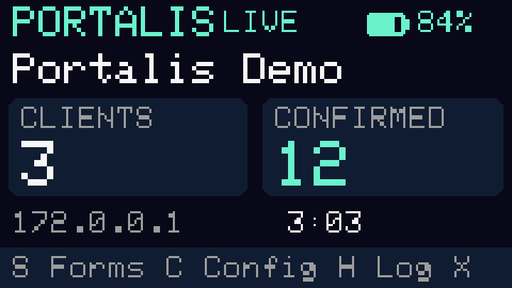 |  |
| **KARMA setup** | **Device settings** |
|  |  |
| **Main menu** | **Saved feedback** |
| 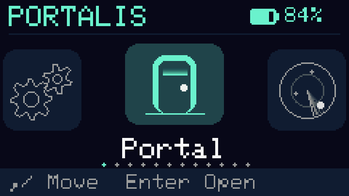 |  |
| **Channel analyzer** | **Signal tracker** |
| 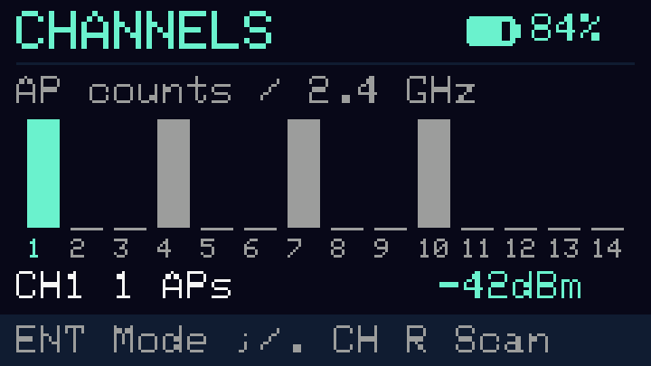 | 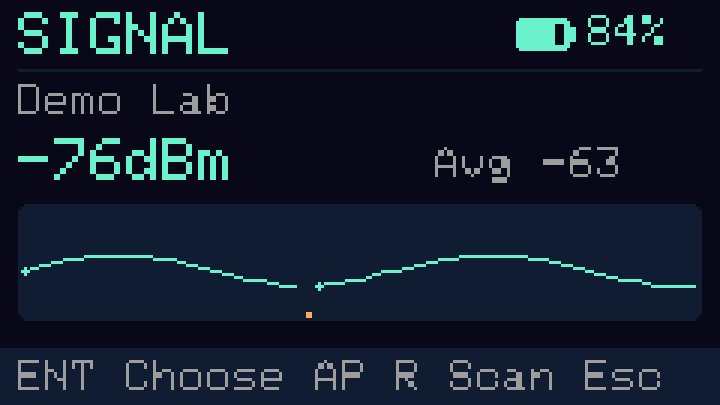 |
| **Connection diagnostics** | **Ping monitor** |
| 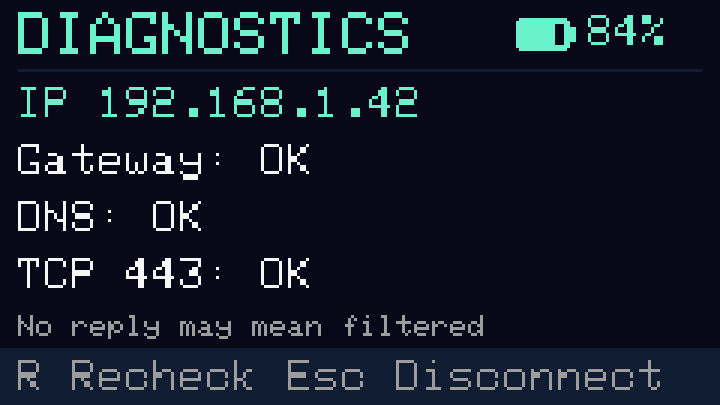 | 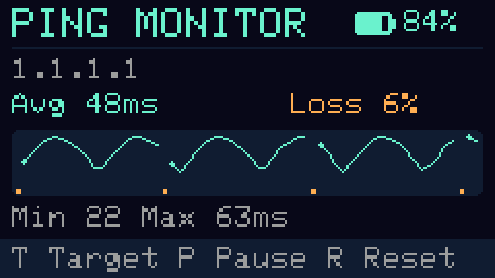 |
| **Network changes** | **Saved Wi-Fi networks** |
| 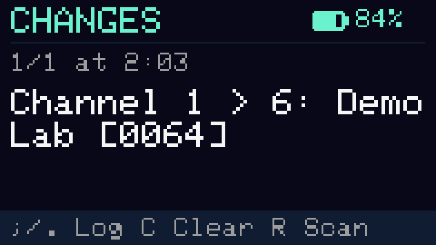 | 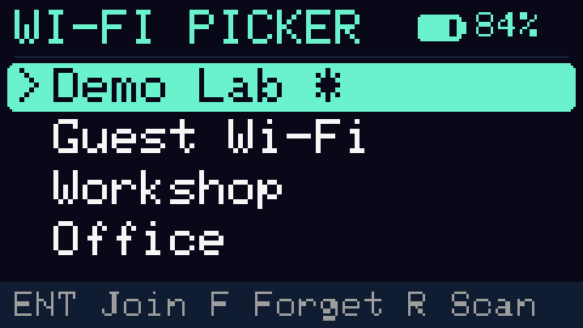 |
| **IP range scan setup** | **Discovered hosts** |
| 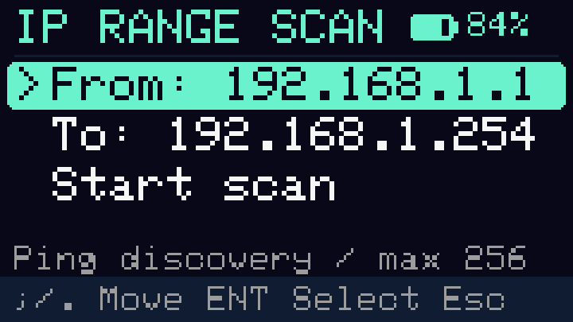 | 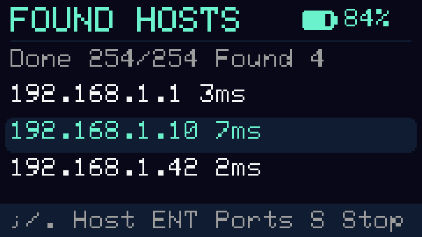 |
| **Host port scan setup** | **Open TCP ports** |
| 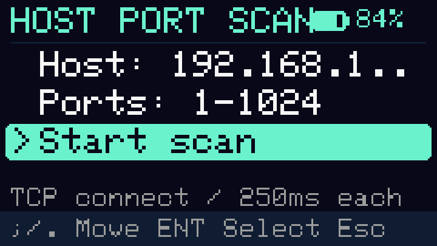 | 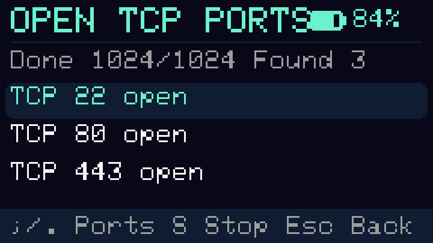 |
| **SSH setup** | **SSH terminal** |
| 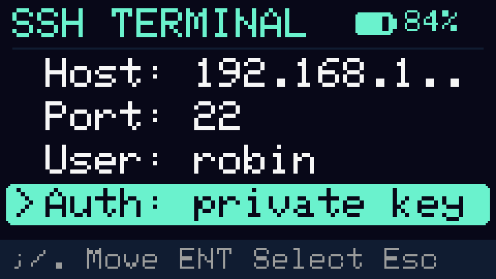 | 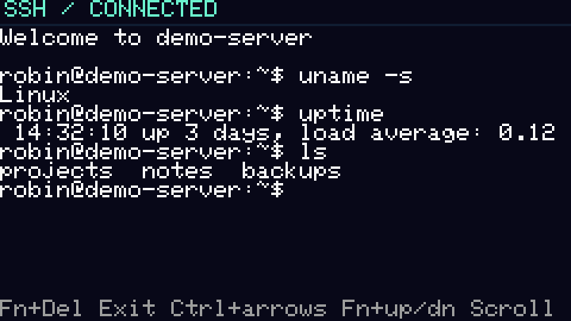 |
| **SSH host-key verification** | **Joining a protected network** |
| 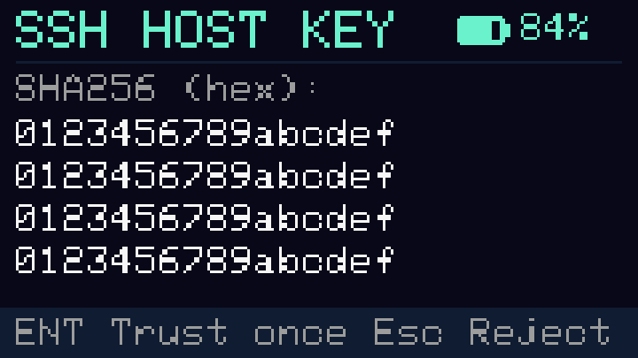 | 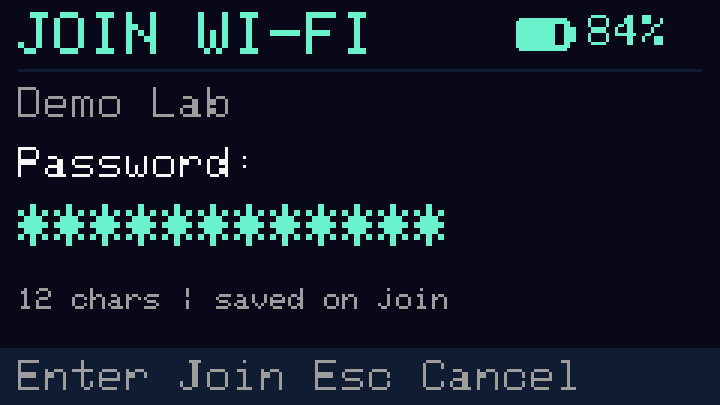 |
| **New Port Scan icon** | **Meshing Settings gears** |
| 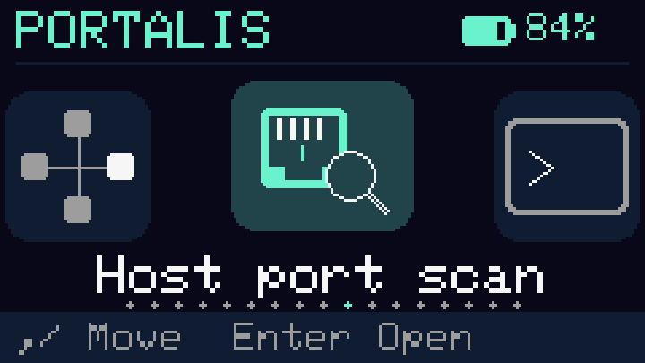 | 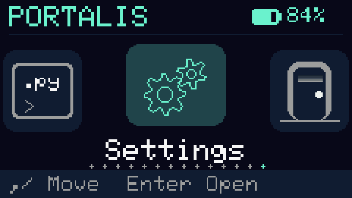 |
| **Packet capture setup** | **Live capture** |
| 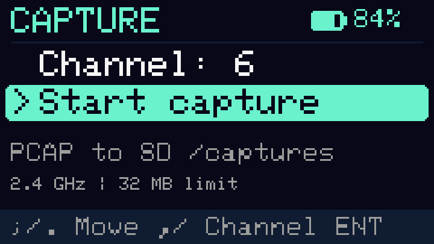 | 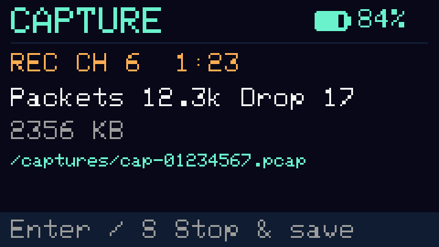 |
| **Python script picker** | **MicroPython output** |
| 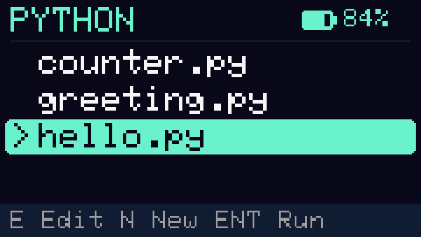 | 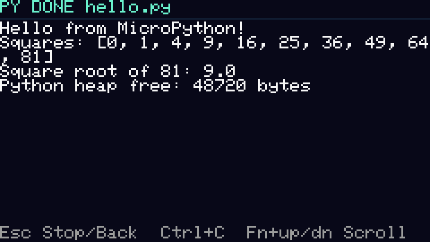 |
| **Wi-Fi survey recorder** | **Local file transfer** |
| 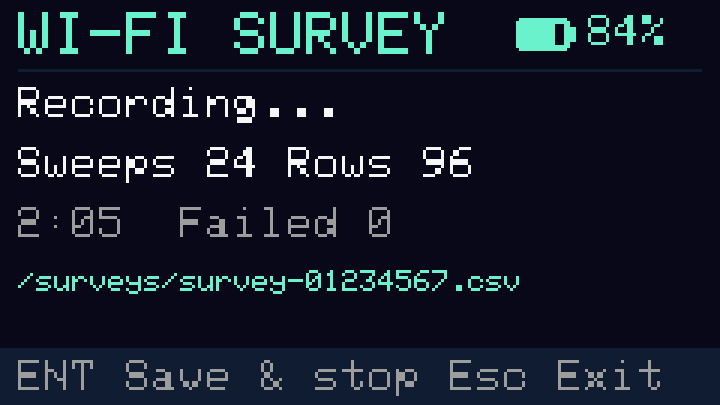 | 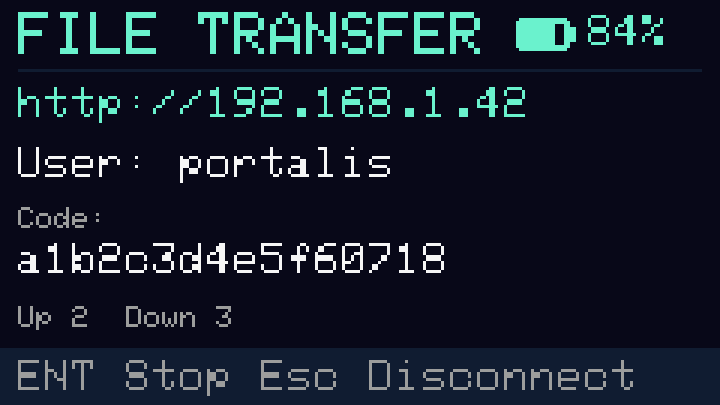 |
| **On-device script editor** | **Saved SSH hosts** |
| 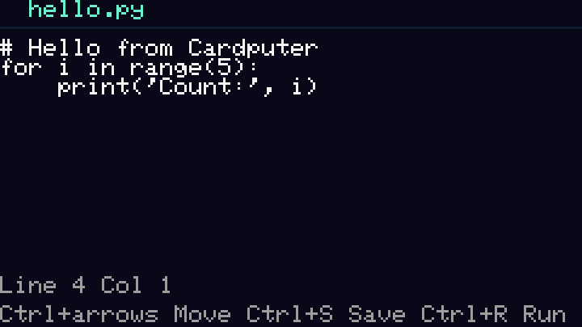 | 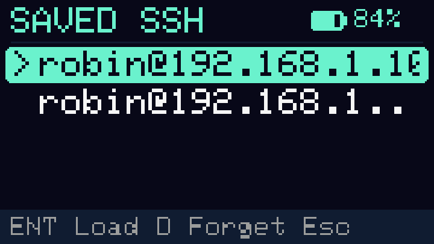 |
| **Open a scanned port** | **Telnet terminal** |
| 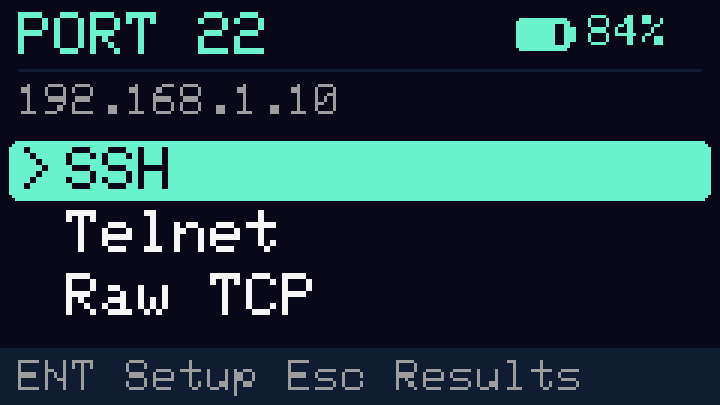 | 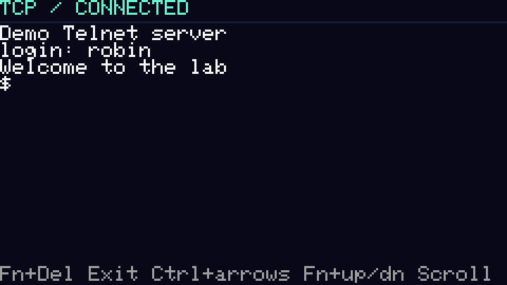 |

## Install

**New in v2.3.0:** record Wi-Fi surveys, transfer SD files through a local browser page, edit Python on-device, save SSH hosts, and open SSH/Telnet/raw TCP sessions from port-scan results.

Download **[portalis.bin from the latest release](https://github.com/ro8inmorgan/portalis/releases/latest)** and flash it at **`0x0`**. It is the complete image: bootloader, partition table, and application. Back up any existing firmware/settings first.

Releases contain only `portalis.bin` plus GitHub's automatic source-code ZIP and tar.gz downloads. You do not need a separate application binary.

1. Insert a FAT32 SD card for custom HTML pages, saved form submissions, packet captures, and Python scripts.
2. On a blank writable card, Portalis creates `/portalis.json` with the default settings.
3. Copy your HTML files to the card, or use the optional [example templates](sd-card). The normal Portal mode also has a built-in Aurora page.
4. Open **Portal**, choose an AP name and page, then select **Start portal**.
5. Join the network and open the captive-network notification, or visit **http://172.0.0.1**.

The AP is local and does not provide internet access. Broadcasting starts only when you choose Start.

For Python, copy the [example scripts](sd-card/scripts) into `/scripts` on the SD card and open **Python scripts**. For packet capture, open **Packet capture**, select a channel, and start recording; saved `.pcap` files appear in `/captures`.

## What you can do

Each tool has its own animated main-menu icon: **Portal → Wi-Fi radar → KARMA → Channels → Signal tracker → Diagnostics → Ping monitor → Network changes → IP range scan → Host port scan → SSH terminal → Packet capture → Python scripts → Wi-Fi survey → File transfer → TCP terminal → Settings**. Settings is last.

### Portal

- Create an open 2.4 GHz access point with a typed name or a configured preset; supports up to four connected clients.
- Serve HTML/HTM pages from SD, including templates in subfolders, or use the built-in Aurora page.
- Browse templates alphabetically, with folders first, and reload the SD card from the picker.
- Collect feedback through ordinary HTML forms, with browser validation and a generic confirmation page after submission.
- Watch live client and confirmation counters, with animated pulses when their values change.
- View timestamp history and saved form submissions while the portal continues running.
- Remember the selected AP name and template across reboots.

### Wi-Fi radar

- Passively scan nearby 2.4 GHz access points and keep the strongest 32.
- Switch between an animated radar and a list showing SSID, signal strength, channel, and security.
- Refresh manually or let scanning refresh automatically.
- Stronger signals appear nearer the radar center. Position is illustrative, not a measured direction or distance.

The scanner lists access points, not connected client devices. Scanning and portal operation are mutually exclusive.

### Join and remember Wi-Fi networks

Diagnostics, Ping, IP range scan, Host port scan, SSH, File transfer, and TCP terminal need a network connection. Choose a visible network in the picker and enter its password; open networks connect directly. Successfully joined networks are saved automatically and marked with `*` in the picker. Selecting one reconnects with its stored password.

- Remembers up to **five networks**, with the oldest profile replaced when full.
- Password entry is masked. Failed joins do not overwrite saved credentials.
- Press **F** on a saved network in the picker to forget it. This also lets you enter a changed password on the next attempt.
- Profiles are saved in device NVS across reboots, independently of the SD card. This firmware does not enable flash encryption.
- Supports visible open and personal WPA/WPA2/WPA3 networks. Hidden SSID entry, WEP, and enterprise authentication are not implemented.
- Joining/address assignment has a **30-second timeout**. A disconnect is shown explicitly.

The radio is dedicated to the selected mode. Connected network tools cannot run alongside a portal or passive scan. Leaving disconnects from the network; if a DNS check is in progress, cleanup may take about 15 seconds while the UI remains responsive.

### Channel analyzer

- View AP counts across 2.4 GHz channels 1–14, with the strongest RSSI for the selected channel.
- Counts cover **all returned scan records**, not only the strongest 32 shown in the network picker.
- Press **Enter** to switch between AP counts and a relative overlap estimate based on channel spacing and signal strength.
- Use `;` / `.` to select a channel and **R** to refresh.

This is a Wi-Fi scan analysis, not a spectrum analyzer or a measurement of airtime/channel utilization. Results are limited to channels available to the radio in its configured country.

### Signal tracker

- Select an AP and track its **BSSID**, so similarly named networks do not get mixed together.
- Display current RSSI, a recent average, and a **60-sample graph**.
- Keep tracking the selected AP even when it falls below the strongest 32 scan results.
- Missing/failed scans appear as gaps; old readings are not presented as current.
- **Enter** chooses another AP; **R** requests a refresh.

Each sample is one completed scan, not one second. This tool works without joining the network.

### Connection diagnostics

Join a network and check these stages independently:

| Check | What it measures |
| --- | --- |
| Address assignment | Whether the station joined and obtained an IPv4 address; the assigned address is displayed |
| Gateway | Three ICMP echo attempts to the network's gateway |
| DNS | Resolution of `example.com` using the network's DNS configuration |
| Outbound TCP | A TCP connection to `1.1.1.1:443` |

Press **R** to rerun the checks. A gateway can filter ICMP, and networks can block the chosen TCP destination; a failed check alone does not prove the internet is down. This does not perform an HTTP login or verify arbitrary websites.

### Ping monitor

- Starts with the connected network's gateway as its target.
- Press **T** to enter another **IPv4 address**.
- Sends approximately one ping per second, with a one-second reply timeout.
- Shows a **60-result latency graph**, session minimum/average/maximum latency, and packet-loss percentage.
- Timeouts are marked as gaps. **P** pauses/resumes; **R** resets statistics.
- Changing target starts fresh statistics. Wi-Fi disconnects are reported explicitly.

Hostname targets are not implemented; use a numeric IPv4 address. An unanswered ping can mean ICMP filtering rather than a disconnected host.

### Network-change monitor

- Takes an initial baseline, then compares successive successful scans by BSSID.
- Reports newly seen/not-seen APs and changes to channel, security mode, or SSID.
- Keeps the latest **32 events in RAM**, with device-uptime timestamps.
- **`;` / `.`** browse events, **C** clears the log/baseline, and **R** requests another scan.
- Failed scans do not produce disappearance events. Dense scans are marked `Top32`, and absence reports are suppressed when results are truncated.

This mode compares the strongest 32 APs. “Seen” and “Not seen” describe scan observations, not proof that a network was created or shut down. It does not require joining a network and does not save its event log to SD.

### IP range scan

- Join a Wi-Fi network, edit **From** and **To**, then select **Start scan**.
- Defaults to usable addresses in the connected subnet, or the device's local `/24` on larger subnets.
- Scans up to **256 IPv4 addresses**, inclusively, using one ICMP echo per address with a **350 ms** timeout.
- Shows progress, discovered hosts, and response times. Results stay in RAM.
- Select a host with **`;` / `.`** and press **Enter** to open its port-scan setup. The active range scan stops and its result list is preserved.
- **S** stops the scan and keeps partial results; **Esc** returns to setup.

Devices that filter or miss the ping may not appear. An empty result does not prove the range has no devices. You can enter a host directly in Host port scan without discovering it first.

### Host port scan

- Available from its own main-menu icon or from a discovered IP.
- Enter a host IPv4 address and a TCP range such as **1–1024**, or a single port such as **443**.
- Defaults to **1–1024**; supports ports **1–65535**.
- Tries TCP connections with a **250 ms** timeout and immediately closes them; sends no application payload and does not scan UDP.
- Shows progress and open ports. Keeps the first **256 open-port results** and reports the total found if more are open.
- **S** cancels with partial results; **Esc** returns to setup. From a discovered host, **Esc** from port setup returns to the original host list.

A filtered full-range scan can take hours. Both scans stay responsive, stop on Wi-Fi loss, and operate only after you explicitly choose Start scan.

### SSH terminal

Open **SSH terminal** from the main menu and join Wi-Fi. Set **Host**, **Port** (default 22), **User**, and **Auth**, then choose **Connect**.

- **Password:** enter the account password in the masked Password field.
- **Private key:** place your OpenSSH/PEM private key on SD (default `/ssh/id_ed25519`), set its absolute path, and enter its passphrase if encrypted. Key files are limited to **16 KB**. Key-format and encryption support follows the pinned [LibSSH-ESP32 5.10.0 library](https://github.com/ewpa/LibSSH-ESP32).
- Before authentication, the device displays the server's **SHA-256 host-key fingerprint in hexadecimal**. Compare it with a trusted fingerprint for that server. **Enter** trusts it for this connection; **Esc** rejects it. Host keys are not silently accepted or permanently stored.
- Passwords and passphrases are not saved to NVS or SD. They are cleared from the application's buffers after authentication or cancellation. Your private-key file remains on the SD card.
- Supports hostnames and numeric IPv4 addresses, password authentication, and private-key authentication. Keyboard-interactive/MFA prompts are not implemented.
- The shell uses a **40-column × 14-row** PTY with a basic ASCII/VT100-style display and **96 lines of scrollback**. Cursor movement, line clearing, wrapping, and common escape sequences work; color styling is ignored, non-ASCII characters are replaced, and full-screen application compatibility is limited.
- SSH negotiation and I/O run outside the UI task. Connection/authentication failures and remote closure are displayed; a failed memory allocation does not start a session.

| Terminal key | Action |
| --- | --- |
| Enter / Backspace / Tab | Send Return / Delete / Tab |
| Ctrl + letter | Send control character, including Ctrl+C and Ctrl+D |
| Ctrl + `;` / `.` / `,` / `/` | Send Up / Down / Left / Right |
| Backtick-labelled Esc | Send Escape to the remote shell |
| Fn + `;` / `.` | Scroll local history up/down |
| Fn + Backspace | Disconnect SSH and return to its setup menu |

Leaving SSH setup disconnects Wi-Fi. Terminal output is held in RAM and is not written to SD. Remote commands run only when you type and submit them.

### Packet capture / Wireshark

Open **Packet capture** from its main-menu icon, select a channel with **`,` / `/`** (or Enter on Channel), then choose **Start capture**. Insert a FAT32 SD card first. This is a separate passive radio mode; it does not join a network or run alongside the other Wi-Fi tools.

- Captures management, control, and data frames on **one selected 2.4 GHz channel**, including observable exchanges between nearby devices and their access point—not just traffic addressed to the Cardputer. This does not guarantee visibility of every device or every packet on the network. Channels 1–13 are selectable; the driver's current country configuration must permit the selected channel. There is no channel hopping or 5 GHz capture.
- Writes unique **`/captures/cap-XXXXXXXX.pcap`** files without overwriting existing captures. The PCAP contains Radiotap channel, signal strength, and FCS metadata, with up to **2,500 bytes per Wi-Fi frame**; larger frames are marked truncated.
- Shows saved packets, dropped packets, elapsed time, file size, and filename. A bounded eight-packet queue feeds a separate SD writer task; busy traffic or slow cards can cause drops. These counters describe frames delivered by the ESP32, not all frames transmitted over the air.
- **Enter**, **S**, or **Esc** stops reception, drains queued packets, and closes the file. Wait for **SAVED** before removing the SD card, then press Enter/Esc to return. Capture also stops at **32 MiB**. An SD write failure displays an error; the last record may be incomplete.
- Files are flushed about once per second and on Stop. Power loss or card removal while recording can lose buffered data or leave a partial file.
- Copy the `.pcap` file to your PC and use **Wireshark → File → Open**. Examples of display filters are `wlan`, `wlan.addr == aa:bb:cc:dd:ee:ff`, and `wlan.fc.type == 2` (data frames).
- Timestamps are microseconds elapsed since capture started, not wall-clock dates. In Wireshark choose **View → Time Display Format → Seconds Since Beginning of Capture**.
- Encrypted Wi-Fi payloads remain encrypted; this is raw capture, not automatic decryption or a full Wireshark interface on the device.

The format was checked with a desktop packet decoder using a synthetic beacon. Native tests cover PCAP/Radiotap encoding, truncation, overflow, SD failure, stop/drain, and UI bounds; real capture throughput and RF behavior still need testing on a Cardputer.

### Python scripts / MicroPython

Put single-file **`.py` scripts in `/scripts` on SD**, then open **Python scripts** from the main menu. Select a file with **`;` / `.`** and press **Enter** to run it directly on the Cardputer. No PC, SSH connection, or internet is needed. Copy the examples from [`sd-card/scripts`](sd-card/scripts) to get started.

- Embeds the official [MicroPython v1.27.0 core](https://github.com/micropython/micropython/tree/v1.27.0/ports/embed) within Portalis. It does not replace the firmware with standalone MicroPython.
- Supports Python functions, classes, loops, lists/dictionaries, comprehensions, integers, floating-point arithmetic, `print()`, and `input()`. Built-in modules include `math`, `gc`, and `sys`. The small `time` module provides `sleep()`, `sleep_ms()`, and `ticks_ms()` (device uptime in milliseconds).
- The picker sorts filenames and shows the first **64** `.py` files directly inside `/scripts`; filenames are limited to **80 bytes** and scripts to **32 KiB**. Press **R** to remount SD and refresh.
- Each run gets a fresh interpreter with a **64 KiB Python heap** and a separate **16 KiB task stack**, with recursion checking. Memory allocation failures and Python exceptions are displayed instead of starting another script.
- Output and tracebacks appear in a **40×14** terminal with **96 lines of scrollback**. **Fn + `;` / `.`** scrolls history. When the header says **INPUT**, type your response (up to 255 ASCII characters), use Backspace to edit, and Enter to submit.
- **Esc** or **Ctrl+C** stops a running script; Esc after completion returns to the picker. Stop aborts the run at a VM/I/O checkpoint and discards its state, so Python exception handlers and `finally` blocks are not guaranteed to run. This also stops scripts that catch `BaseException`. Sleeping, input waits, and output backpressure remain cancellable.
- Python runs separately from the Wi-Fi tools. No scripts run automatically at boot. Source is read from SD once; output is kept in RAM.
- This is an embedded, single-file scripting environment: **no pip, desktop packages, `open()`/SD filesystem binding, imports of other `.py` files, `machine`, `network`, or M5 hardware APIs** in this version. Native `.mpy` extensions and Python threads are disabled. Display output is basic ASCII and long output scrolls off the bounded history.

For example, save this as `/scripts/demo.py`:

```python
import time

name = input("Your name? ")
for number in range(5):
    print(name, number)
    time.sleep_ms(250)
```

The MicroPython source package is vendored under `lib/PortalisMicroPython`, including its MIT license and pinned upstream revision. The port configuration and generator are under `scripts/micropython_port` and `scripts/vendor_micropython.py`; normal firmware builds do not regenerate or download the runtime source.

### KARMA / probe test

- Listen for named Wi-Fi probe requests and temporarily advertise the requested network name.
- Choose an SD HTML template before starting; there is no automatic built-in page for this mode.
- Capture feedback through the same form handler and SD submission viewer as Portal.
- Set the AP timeout before starting: **30–600 seconds**, in 30-second steps, default **120 seconds**. The first observed connection restarts the full countdown; further connections do not.
- Apply a per-device cooldown between attempts; default **120 seconds**.
- View attempt and join counts, a remaining-time countdown, and the latest 32 test results.
- Remember the selected template and menu timeout across reboots.

The current implementation accepts any nonempty parsed SSID; it does not enforce an approved-name list. A recorded association does not prove that the device which sent the probe joined. MAC randomization also limits per-device cooldown accuracy. Stopping/restarting clears that session's cooldowns and counters.

### Templates and form inputs

Use a regular HTML form—no custom JavaScript or form action is required:

```html
<form>
  <label>
    Rating
    <select name="rating" required>
      <option value="">Choose a rating</option>
      <option value="great">Great</option>
      <option value="okay">Okay</option>
    </select>
  </label>
  <label>Feedback <textarea name="feedback"></textarea></label>
  <label><input type="checkbox" name="follow_up" value="yes"> Request follow-up</label>
  <button type="submit">Send feedback</button>
</form>
```

Portalis supplies a handler that posts the submitted form to `/confirm`. Supported data includes named inputs, textareas, selects, multiple selections, radio buttons, checkboxes, the clicked submit button, and small file uploads. Repeated names remain separate entries. Controls associated with a form using `form="id"` also work.

Normal browser rules apply: unchecked checkboxes/radios, disabled or unnamed controls, and unclicked buttons are omitted. Native `required`, `pattern`, and other validation rules still apply. Only the submitted form is recorded.

- Inline CSS and data-URL images are supported; external assets and template JavaScript are blocked.
- Templates: **32 KB** maximum.
- Submissions: **16 KB**, up to **64 entries**, with field names up to **256 bytes**.
- File uploads: **8 KB total**, stored with filename, MIME type, and base64 content.
- Each page ticket permits one accepted submission within five minutes. Reload for another submission.
- A writable SD card is required to accept submissions containing fields.

### Saved submissions and history

- Submissions are stored in `/portalis/submissions.jsonl`; timestamp events are stored separately in `/portalis/events.csv`.
- Browse submissions newest first and open them to read field names and values on the device.
- Scroll long values and see repeated fields separately. Uploaded files show metadata; retrieve their contents from the SD log.
- Saved records remain available after reboot. Original text and Unicode are preserved on SD; unsupported device-font characters display as `?`.
- Each log is capped at **256 KB**. Archive/remove it to resume logging when full. Failed submission saves show an error and allow retry.
- Portal confirmation history retains the newest 96 events in RAM. Times are elapsed session times, not calendar timestamps.

The Wi-Fi network is open and SD logs are unencrypted. Use feedback forms appropriate for that environment.

### Appearance, LED, and audio

- Six UI accent colors and three background palettes.
- Shimmering startup logo, animated carousel icons, pulsing counters, and an estimated battery percentage.
- LED brightness from 0–100%, plus independent idle, connection, confirmation, and disconnect colors.
- Five LED modes: **Breathing, Steady, Blink, Rainbow, Off**. The idle effect runs throughout the app, including the main menu, KARMA and all Wi-Fi tools.
- Interactive LED feedback: menu navigation/selection pulses; scan completion; signal found/lost; network changes; Wi-Fi joins/disconnects; diagnostic results; ping replies/timeouts; KARMA joins/submissions.
- Feedback uses the configured connection, confirmation, and disconnect colors. Portal confirmations take priority over navigation pulses. Settings color previews remain available.
- **Off** or **0% brightness** disables all LED output, including activity feedback.
- Live LED previews in Settings, including while the portal is stopped.
- Menu click sounds and separate connection, confirmation, and disconnect chimes in both Portal and KARMA. Successful submission saves trigger the confirmation chime.
- Independent menu/event sound toggles and volume from 0–100%.
- Device settings persist across reboots without needing an SD card.

On Cardputer ADV, LED power shares the display-backlight pin: enabled LED effects use full display brightness throughout the app, returning to normal brightness when LED mode is Off or brightness is 0%. Battery percentage is a voltage-based estimate, not a precise fuel gauge or charging indicator.

## Controls

| Screen | Keys |
| --- | --- |
| Main menu | `,` / `/` move between all fourteen icons; Enter opens; Settings is last |
| Menus | `;` / `.` move; Enter selects; Esc/back returns |
| Template picker | Enter opens; Backspace goes up; `R` remounts SD |
| Portal dashboard | `S` submissions; `H` history; `C` settings; `X` stop confirmation |
| Radar | `;` / `.` select AP; Enter toggles radar/list; `R` refreshes; Esc stops |
| Wi-Fi picker | `;` / `.` select; Enter joins/tracks; `F` forgets a saved network; `R` scans |
| Channels | `;` / `.` select channel; Enter toggles counts/overlap; `R` scans; Esc exits |
| Signal tracker | Enter chooses another AP; `R` scans; Esc exits |
| Diagnostics | `R` rechecks; Esc disconnects |
| Ping monitor | `T` target; `P` pause/resume; `R` reset; Esc disconnects |
| Network changes | `;` / `.` browse; `C` clear; `R` scan; Esc exits |
| IP range / port setup | `;` / `.` select field; Enter edits or starts; Esc returns/disconnects |
| Range results | `;` / `.` select host; Enter opens port setup; `S` stops; Esc returns |
| Port results | `;` / `.` scroll; `S` stops; Esc returns |
| SSH setup | `;` / `.` select; Enter edits/toggles/connects; Esc disconnects Wi-Fi |
| SSH terminal | Type commands; Ctrl combos; Fn+Backspace exits; see terminal controls above |
| KARMA setup | Page selects HTML; Timeout adjusts with `,` / `/` or Enter (+30s); Start begins |
| KARMA shortcuts | `S` start/stop; `T` templates while stopped; `V` submissions; `H` log; `R` reload while stopped |
| Settings | `;` / `.` select; `,` / `/` adjust; Esc/Backspace saves |
| Submissions | `;` / `.` select or scroll; Enter opens; `R` refreshes the list |

Esc is the backtick-labelled key. The arrow-labelled keys are `;`, `.`, `,`, and `/`.

## SD configuration

Fresh installations create `/portalis.json` with:

```json
{
  "ap_names": ["Portalis Demo", "Portalis Guest", "Portalis Workshop"],
  "cooldown_seconds": 120,
  "timeout_seconds": 120,
  "notice_template": ""
}
```

- `ap_names`: up to 32 presets, each 1–32 printable ASCII characters, without leading/trailing spaces. Manual naming remains available.
- `cooldown_seconds`: 60–86400 seconds between attempts for a device.
- `timeout_seconds`: 30–600 seconds for each temporary AP, restarted once on the first observed connection.
- `notice_template`: optional absolute path to a probe HTML file, such as `/feedback.html`. Empty means choose a file before starting.

The config is limited to 4 KB. Existing files are preserved. Saved KARMA menu selections override the config's template and timeout. Every start reloads the selected HTML file.

**Upgrading:** move `cooldown_seconds` and `notice_template` from an older `probe-test.json` into `portalis.json`; the old file is no longer read.

## Build and test

With [uv](https://docs.astral.sh/uv/) installed, run from the project directory:

```sh
uvx --with requests --with intelhex --from platformio pio run -e cardputer
uvx --with requests --from platformio pio test -e native
python3 scripts/test_python_runtime.py
```

Dependencies are pinned in `platformio.ini`. The flashable output is `dist/portalis.bin`. Local builds also produce an application-only image, manifests, and ZIP packages for development; only the full image is uploaded to releases.

**Validation:** firmware builds include a guard limiting the compiled UI stack frame to 2 KB, addressing the main-menu restart regression introduced during scan development. Native tests cover scanner state, terminal parsing, authentication flow, cancellation, and UI bounds; the SSH transport is mocked in native tests. The current full run has **94 passing tests and four failing probe assertions**: two legacy `test_probe_scope` tests expect an SSID restriction that the current implementation does not enforce, and two `test_probe` deadline tests expect the timer not to restart on the first join. The scanner, SSH, Python runner, and UI suites pass. The Python runner lifecycle tests mock the VM, while `python3 scripts/test_python_runtime.py` independently compiles the real embedded MicroPython core and checks execution, input, exceptions, memory/recursion limits, GC, cancellation, and fresh-run isolation. The separate runtime check passed **12 real-MicroPython checks and all three sample scripts**. Physical-device scanning/capture, sustained SD throughput, SSH interoperability, speaker behavior, and MicroPython on-device behavior still need hardware validation.

To regenerate the previews after building dependencies:

```sh
uv run --with pillow python scripts/render_ui.py
```

The preview tool compiles the real `drawUi()` function against a host drawing adapter and uses M5GFX's GLCD font. Shapes are rasterized with Pillow, so edge pixels may differ slightly from the hardware display.

See [README.txt](README.txt) for further implementation details and limits.

### Wi-Fi survey recorder

Open **Wi-Fi survey** and press **Enter** to start or stop. Each completed scan saves the strongest 32 AP observations to `/surveys/survey-XXXXXXXX.csv`: elapsed milliseconds, sweep number, total APs seen, SSID, BSSID, channel, RSSI, and security. Failed and empty scans are recorded explicitly. Recording stops at 8 MiB. This uses nearby Wi-Fi scans without joining a network; timestamps are relative to recording start, with no GPS location.

### Local file-transfer page

Open **File transfer**, join Wi-Fi, and press **Enter**. On another device on the same reachable LAN, open the displayed HTTP address and sign in as **portalis** with the temporary five-character code shown on the Cardputer.

- Upload `.py` files to `/scripts` and `.html`/`.htm` templates to the SD root, up to **32 KiB** each. Replacing an existing file requires the checkbox.
- Download scripts, root-level templates, `/captures/*.pcap`, and `/surveys/*.csv`; browse 64 files per page.
- SSH keys, device configuration, and form submissions are outside this page's folders.
- Transfers use temporary files and preserve a backup during replacement. If SD recovery fails, a `.bak` file remains for recovery on a computer.
- Press **Enter** to stop; wait until stopped before removing SD. This service uses HTTP without TLS, so use a trusted LAN. The access code changes each time it starts.

### On-device script editor

In **Python scripts**, press **N** to create a file or **E** to edit the selected file. The editor supports ASCII scripts up to **8 KiB**; larger scripts can still be transferred separately. Tabs become four spaces and CRLF line endings are normalized when loaded.

| Control | Action |
| --- | --- |
| Ctrl + arrow keys (`; . , /`) | Move cursor, scrolling as needed |
| Enter / Tab | New line with existing indentation / four spaces |
| Ctrl+S | Save to SD |
| Ctrl+R | Save and run in the existing MicroPython runtime |
| Esc | Exit; choose Save, Discard, or Keep editing when modified |

### Saved SSH hosts and port actions

SSH setup now includes **Saved hosts** and **Save host**. Up to eight profiles persist in NVS: hostname, port, username, authentication mode, and private-key path. Passwords and key passphrases are never saved in these profiles. Select a profile with **Enter**, or forget it with **D**. Host-key confirmation still happens for each connection.

In **Host port scan**, select an open port and press **Enter** for **SSH**, **Telnet**, or **Raw TCP**. The scan stops before connecting and its results are retained. Port 22 selects SSH by default, port 23 selects Telnet, and other ports select raw TCP. SSH reuses a matching saved host profile when available.

### Telnet and raw TCP terminal

Open **TCP terminal** from the main menu, or use a port-scan result. Set the hostname/IP, port, and mode, then connect. Telnet performs basic option negotiation; raw TCP displays received text directly and locally echoes typed text. Neither mode provides TLS, UDP, or a binary packet viewer. Some services only respond after receiving a protocol-specific command.

**Enter** sends CRLF; **Ctrl+letters** sends control characters, **Ctrl+arrows** sends terminal arrow sequences, **Fn+up/down** scrolls output, and **Fn+Del** disconnects. Output remains available after a remote disconnect. Telnet and SSH use the existing limited ANSI terminal renderer.
